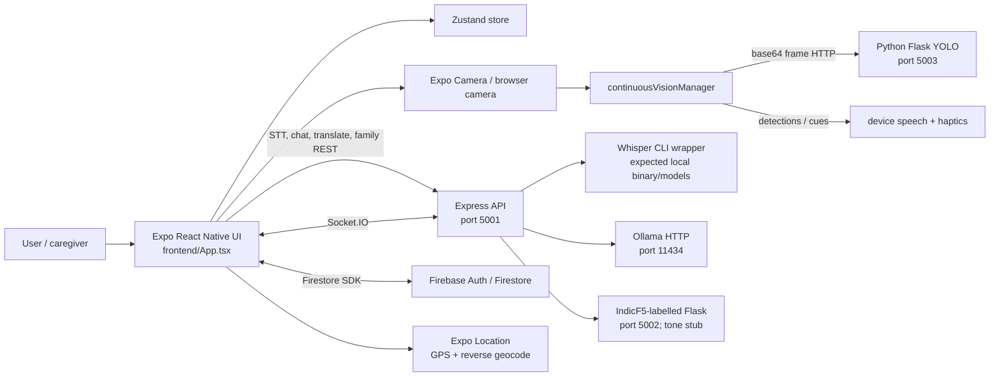

# NAVIDOOR — Project Audit and Implementation Status

**Audit type:** Read-only source inspection. This report is the only file created at the user's explicit request.  
**Audit date:** 2026-11-02.  
**Evidence convention:** Source presence is not runtime verification. README/architecture claims are not treated as proof. No build, service, test suite, migration, install, database write, or external API request was run.

## 1. Executive summary

NAVIDOOR is a cross-platform Expo / React Native prototype with a Node.js Express + Socket.IO backend, a Python Flask YOLO inference service, and a second Python speech service. The code includes accessibility-oriented screens, camera capture and frame submission, language/voice-command logic, an Ollama integration, GPS display, and family pairing code using Firestore and Socket.IO.

The strongest end-to-end source path is live camera frame → YOLO HTTP request → object/hazard analysis → spoken cue. That path is wired but was not executed. Four YOLO weight files are present (general model at repository root and custom staircase, pothole and crosswalk weights under `yolo/models`). OCR, routing, speech model files and Whisper binaries are absent. Several UI journeys rely on seeded content or hard-coded examples. Family REST login/register/dashboard are demo responses and backend pairing state is in memory. `/api/tts` calls an IndicF5-labelled server that currently returns a generated sine-wave WAV, not speech. Emergency SOS sends a generic string through an unauthenticated broadcast, without current GPS, SMS or calling.

This is an **integration-stage prototype**, not a complete assistive navigation product. React Native, Expo, TypeScript, Zustand, Express, Socket.IO, Firebase SDK / Firestore rules, Ultralytics YOLO, Expo camera/audio/speech/location and FFmpeg are evidenced. React Navigation is declared but no navigator use was found. No PaddleOCR/Tesseract, Piper, Vosk, Coqui, ONNX Runtime, TFLite, RT-DETR, SAM, MediaPipe, GraphHopper, Valhalla, OSM routing, FCM or Realm integration was found. GPS position display exists; route calculation does not.

**Safety:** monocular distance, corridor clearance, and spoken path hints are heuristics, not validated mobility guidance. Present the application as a prototype, not as a safety-critical substitute for a cane, guide dog, trained mobility aid or verified route service.

## 2. Actual project purpose and current stage

Source supports describing NAVIDOOR as an assistive-technology prototype providing:

- A mobile/web UI with role selection, onboarding, camera canvas, mode wheel, profile/settings/history/emergency/family panels.
- Camera capture and a Python YOLO service path that formats object/hazard cues.
- Voice capture through Expo Audio on native devices or browser media APIs, an Express `/api/stt` wrapper intended to invoke local Whisper.cpp, local Ollama chat integration, and device/browser speech synthesis.
- GPS and reverse-geocoding location display using Expo Location.
- Family pairing and live event plumbing through Firestore, Socket.IO and REST fallback, with inconsistent backends and mock endpoints.
- Local client state for medicine entries, emergency contacts, route steps, profile and preferences; not a complete persistent medicine, route or emergency system.

The code does **not** substantiate a working OCR reader, bus destination OCR or real-time transit feed, pedestrian routing, indoor positioning, medication recognition/scheduling/notifications, SMS/call emergency flow, or complete family monitoring product.

## 3. Repository structure and architecture

```text
NAVIDOOR/
├── frontend/                 Expo React Native app (TypeScript)
│   ├── App.tsx               role split and main component composition
│   └── src/
│       ├── components/       camera, onboarding, mode wheel, panels, family, SOS
│       ├── services/         camera AI, audio, API, Socket.IO, Firebase, pairing
│       ├── store/            Zustand application state and actions
│       ├── theme/            design tokens
│       ├── types/            application types
│       └── utils/            speech, translations
├── backend/
│   ├── index.js              Express routes, multer, Socket.IO server
│   ├── services/             Ollama, YOLO proxy, Whisper wrapper, translation, TTS
│   ├── indicf5/              Python Flask speech endpoint
│   ├── config/languages.js   language metadata
│   ├── scripts/              speech setup and diagnostics
│   └── test_*.js             authored verification scripts (not run)
├── yolo/
│   ├── yolo_server.py        Flask image inference endpoints
│   ├── core/                 detection, labels, distance, scene, guidance
│   ├── models/*.pt           three custom YOLO weight files
│   └── test_*.py             authored diagnostics (not run)
├── yolo11n.pt                root-level general model artifact
├── firestore.rules           Firestore rules for pairing, connections, users
├── README.md                 project claims and setup
├── ARCHITECTURE.md           intended/design architecture
└── SPEECH_SETUP_GUIDE.md     setup instructions; model assets not present
```

Root and `frontend/` contain copies of app metadata and package manifests. Root `App.tsx` is a short re-export; actual app is `frontend/App.tsx`. This is configuration drift risk. README version/feature claims are not consistently supported by checked-in manifests and code.

### Architecture diagram



Mobile vision tries Python port 5003 directly and falls back to Node proxy routes. Backend family routes store process-local arrays/maps, while client Firestore operations are also present. These are not one consistent persistence design. There is no server database model/schema/migration layer. GPS is not connected to a route engine.

## 4. Technology stack investigation

| Technology | Presence/configuration/code evidence | Feature integration and assessment |
|---|---|---|
| React Native | Declared `0.88.0`; used | Main app UI; not built here. `frontend/package.json`, `frontend/App.tsx` |
| Expo | Declared `~58.0.19`; camera/audio/location/speech/haptics declared | Runtime/native API integration; device behavior unverified. `frontend/package.json`, `frontend/app.json` |
| TypeScript | Declared and used throughout | Typecheck not run; dependencies absent. `frontend/tsconfig.json`, `frontend/src` |
| React Navigation | Native and bottom-tabs declared | No NavigationContainer/Navigator use located; likely unused. `frontend/package.json` |
| Zustand | Declared and imported | Central in-memory app state; no persistence middleware found. `useNavidoorStore.ts` |
| Node.js | Backend source uses Node APIs | Version not verified. `backend/index.js` |
| Express | Declared and used | REST API; no authentication middleware. `backend/index.js` |
| Socket.IO | Server/client declared and used | Chat, SOS, spatial, family event transport; global and unauthenticated behavior is unsafe for private data. |
| YOLOv11 / Ultralytics | Python requirements declare `ultralytics>=8.3`; detector loads YOLO; weights exist | Real inference path conditional on package/model load; not run. `yolo/core/detector.py`, `yolo/models/*.pt` |
| YOLOv10 / YOLOv8 | Mentioned in comments/docs only | No distinct version integration evidenced. |
| RT-DETR | Not found | Not implemented. |
| MobileSAM / FastSAM | Not found | Not implemented. |
| OpenCV | Not in `yolo/requirements.txt` or source usage found | Not integrated. |
| MediaPipe | Not found | Not implemented. |
| ONNX Runtime / TensorFlow Lite | Not found | Not implemented. |
| PaddleOCR / Tesseract | Not found | No OCR engine. OCR labels/sample UI are not OCR. |
| Whisper.cpp | Wrapper expects `main.exe`/`main` and ggml files | CLI invocation and conversion path exist, but binaries/models absent from inventory; unusable until provisioned and verified. `whisperService.js`, `SPEECH_SETUP_GUIDE.md` |
| Piper / Vosk / Coqui | Not found | Not implemented. |
| AI4Bharat IndicF5 | Node client, Python service and `f5-tts` dependency declared | Not actual inference: `/synthesize` generates a 480Hz tone WAV. `backend/indicf5/indicf5_server.py` |
| Ollama | Node service calls local `/api/tags` and `/api/generate` | Integration path; local service/model required, not run. `aiAssistantService.js` |
| OpenStreetMap / GraphHopper / Valhalla | Not found | No map/routing provider or library. |
| QR navigation | QR scanner exists for family pairing | No indoor QR waypoint navigation. |
| Bluetooth beacons | Not found | Not implemented. |
| SQLite / Realm | Not found | Not implemented. |
| Firebase | Firebase Auth/Firestore dependencies and code; rules file present | Anonymous auth attempt, client-side pairing documents. Live config/deployment unverified; fallback config contains demo values. |
| Firebase Cloud Messaging | Not found | No remote push notifications. |
| Local notifications | No notification package/API use found | No medicine reminders or scheduled notifications. |
| Expo Location | Declared and imported | Current position, watch and reverse geocoding in `LocationPanel.tsx`; no route calculation. |
| Expo Camera | Declared/configured/imported | Live camera and frame/photo capture; device run not verified. |
| Expo Audio / Speech / Haptics | Declared and used | Mic, device/browser speech and haptics; app announcement helper uses device speech, not neural backend TTS. |
| FFmpeg | `ffmpeg-static` declared and used | Whisper audio conversion path; if conversion fails code falls back to original input. |
| Docker | No Dockerfile/compose found | Not used. |
| Git | `.git` exists | Working tree status could not be established due global ignore permission warnings. |
| Figma / VS Code | No repository evidence | Tool use cannot be inferred. |

## 5. Actual user journey

1. **Launch/role:** `frontend/App.tsx` reads Zustand `userRole`, initially `undecided`, and renders `RoleSelectionScreen`. Role/onboarding state is in memory; durable account setup is not implied.
2. **Onboarding:** `VoiceOnboardingModal` and profile UI can use voice capture and set client state. No demonstrated durable account backend.
3. **Main app:** camera canvas, header, section panels, mode wheel, toast, onboarding, SOS/family/profile modals. A custom mode wheel and swipe gestures drive screens; React Navigation is not used as the routing structure.
4. **Camera:** `CameraViewCanvas.tsx` requests native permission and supports web camera; simulated camera fallback is explicitly not live input. Camera behavior depends on hardware/permissions.
5. **Vision:** in vision modes, `continuousVisionManager` captures native photos or browser canvas frames, base64 encodes them, and calls `yoloVisionService`. The client tries Python direct endpoint then backend proxy. The manager passes detections to track/announcement/haptic logic. Runtime success is unverified.
6. **Voice:** recording service captures native or browser audio with silence timing, then posts to `/api/stt`. Transcription flows to `/api/chat`; backend may call Ollama. Intent parsing handles some UI commands. Speech output mainly uses Expo Speech/browser synthesis. STT requires missing local Whisper assets and speech services have not been run.
7. **Read/OCR:** no OCR package/model/endpoint. Read preview uses seeded sample text; store has a static `activeReadText` that can be spoken. Text from camera is not extracted.
8. **Navigation/location:** Location panel requests foreground location, reads/watch positions, reverse-geocodes. `voiceNavigationService.getStepsForDestination` returns three static sample instructions and distances (45m, 12m, 3m). No route API, map matching or GPS-driven turn progression.
9. **Transit:** YOLO filter can report bus/truck/car. It does not read bus numbers/destination boards or use transit arrivals/routes.
10. **Medicine:** package/bottle coarse classes plus seeded client medicine entries and local decrement/delete. No medicine identity recognition, prescription OCR, durable schedule or notification. No dosage validation.
11. **SOS:** UI, triple-tap, haptic/beep and Socket.IO event exist. `triggerSosAlert` emits generic text, not live GPS. Server rebroadcasts globally. No SMS/call/contact delivery or acknowledgement.
12. **Family:** caregiver screens, QR pairing, Firestore code, REST fallback, Socket.IO. Login/register/dashboard routes return mock identities/static location; REST pairing memory is lost on restart. End-to-end family access/data integrity is unverified.

## 6. Feature-by-feature audit

| Module | Status | Findings |
|---|---|---|
| Smart vision / hazard assistance | **PARTIALLY IMPLEMENTED** | Real-camera frame capture and YOLO HTTP path; specialist stair/pothole/crosswalk files; distance/corridor algorithms and voice cues. Runtime/device accuracy unverified. Monocular size-based range is a heuristic; no temporal collision prediction or validated safe-path guarantee. |
| Person/vehicle/bicycle/motorcycle | **PARTIALLY IMPLEMENTED** | General COCO detector can classify standard categories if loaded; runtime not verified. |
| Stairs/potholes/crosswalk | **PARTIALLY IMPLEMENTED** | Custom weight files conditionally loaded. README benchmark figures are not independently verified. |
| Ramps, lifts/escalators, doors/windows, poles/walls, footpaths, lights, construction, puddles, manholes, dividers, signs | **PARTIALLY IMPLEMENTED** | General labels may catch some common classes; no dedicated validated support for full list. Do not claim reliable puddle/manhole detection from generic classes. |
| Indoor navigation | **NOT IMPLEMENTED** | No indoor map/routing, localization, beacon, landmark, floor/room ID or waypoint QR flow. Family pairing QR is unrelated. |
| Outdoor navigation | **PARTIALLY IMPLEMENTED** | GPS and reverse geocode present; route instructions are static. No pedestrian route calculation, map, provider, safe routing or GPS progress. |
| Public transport | **PARTIALLY IMPLEMENTED** | Bus-like object filter only; no destination OCR, route identity, live arrival data or boarding/exit alerts. |
| OCR reading | **NOT IMPLEMENTED** | No OCR engine/model/API. UI/sample text is static. |
| Medicine assistant | **PARTIALLY IMPLEMENTED** | Seeded list, local tracking and coarse packaging class filter; no named product recognition, schedule/reminders/persistence/family adherence. |
| Voice assistant | **PARTIALLY IMPLEMENTED** | Mic capture, command logic, Whisper wrapper, Ollama integration, device speech. Whisper assets absent; IndicF5 is a tone; offline end-to-end not established. |
| Emergency assistance | **PARTIALLY IMPLEMENTED** | SOS UI, triple tap, beep/haptic, socket event. No actual live GPS/contact delivery, phone/SMS, medical data transmission, protected recipient or acknowledgement. |
| Family companion | **PARTIALLY IMPLEMENTED** | Screens, Firestore/Socket.IO pairing paths. REST login/register/dashboard are mock; REST state volatile; events not access scoped. |
| Accessibility layer | **PARTIALLY IMPLEMENTED** | Voice-first UI, many labels, theme choices, larger controls, gestures/haptics. No comprehensive screen-reader/contrast/target validation; custom gestures may conflict with assistive tech. |
| Offline AI | **PARTIALLY IMPLEMENTED** | Local host services are intended; mobile still depends on host/network, Whisper assets absent, TTS stub, Ollama model external. No bundled offline mobile inference pipeline. |

## 7. AI models and processing pipeline

### Vision

`yolo/yolo_server.py` exposes `/health`, `/detect`, `/detect/bus`, `/detect/medicine`. It accepts base64 JSON or multipart, limits base64 payload to 30 MB, corrects EXIF/orientation, bounds dimensions, downsizes to 1280px and uses a nonblocking inference lock (429 when busy). `yolo/core/detector.py` loads Ultralytics YOLO for primary `yolo11n.pt`, then conditionally loads custom staircase, pothole and crosswalk weights from `yolo/models`. It extracts boxes/confidence/class and calls `DistanceEstimator`, `SceneAnalyzer`, `GuidanceGenerator`.

Files present: `yolo/models/yolo11n_crosswalk.pt` (5,504,666 bytes), `yolo/models/yolo11n_pothole.pt` (5,504,666 bytes), `yolo/models/yolo11n_staircase.pt` (5,466,074 bytes), root `yolo11n.pt` (5,613,764 bytes). The detector searches `yolo/models/yolo11n.pt`; the general root weight is outside that path, so model resolution may depend on Ultralytics behavior or a download. No inference was run. If runtime cannot load, code catches errors and can return empty detections; this does not establish useful fallback inference.

Distance is monocular pinhole-style estimation in `distance_estimator.py`; scene clearance uses image zones in `scene_analyzer.py`. Both require calibration and evaluation. Requirements declare Ultralytics, Flask, NumPy, Pillow, Flask-CORS, requests, OpenCV headless; no ONNX/TFLite runtime or in-app model.

### Speech/language

- `voiceRecordingService.ts` uses Expo Audio on native and browser capture on web. `/api/stt` accepts multipart `audio`, optional `language` and `sourceUri`; Multer writes under `backend/temp`, then Whisper wrapper converts via FFmpeg and invokes a local binary.
- Whisper expects `backend/bin/main(.exe)` and `backend/models/whisper/ggml-{base,small,tiny}.bin`; these were absent from repository inventory. Setup guide instructs obtaining them. Speech cannot be called working from source presence alone.
- `/api/chat` calls `aiAssistantService`; it discovers a local Ollama model using `/api/tags` or defaults and invokes `/api/generate`. Canned intent and validation branches also exist. Ollama and a model are not included or verified.
- Main output helper uses Expo Speech/device voice or browser SpeechSynthesis. Backend `/api/tts` calls the IndicF5-named Python server, but `/synthesize` constructs a sine wave WAV and performs no model inference. It is **not spoken TTS**.
- Translation code and endpoint exist; actual provider/configuration and quality unverified. Ten language codes and UI translations exist, but that does not validate STT/TTS in those languages.
- Whisper.cpp wrapper only; Vosk/Piper/Coqui absent. No full offline speech flow verified.

### Proposed AI items

| Task | Proposed model | Repository reality |
|---|---|---|
| Object detection | YOLOv11/v8 | YOLO/Ultralytics code and weight files present; inference untested |
| Real-time detection | RT-DETR | Absent |
| Segmentation | MobileSAM/FastSAM | Absent |
| OCR | PaddleOCR | Absent |
| Speech recognition | Whisper.cpp | Wrapper present; CLI/models absent |
| Offline STT | Vosk | Absent |
| TTS | Piper | Absent; IndicF5 route is tone stub |
| Pose | MediaPipe | Absent |
| Navigation | GraphHopper | Absent; route helper is static |

## 8. Frontend and mobile analysis

- Main entry: `frontend/App.tsx`; central state/actions: `frontend/src/store/useNavidoorStore.ts`.
- Screens/components: role selection and voice onboarding; camera canvas/header/controls/preview; mode wheel; location, emergency, medical, language, history, settings and family panels; family auth/dashboard tabs; SOS/profile/design modals.
- Custom mode switching is based on Zustand and gestures. React Navigation is declared but no usage was located.
- Camera permission handling and simulated mode live in `CameraViewCanvas.tsx`. `continuousVisionManager.ts` manages frequent captures/tracking/announcement queue. `yoloVisionService.ts` posts images to host service.
- Voice: `UnifiedMicButton`, `voiceRecordingService`, `voiceCommandProcessor`, `voiceAssistantBackend`, `voiceConversationService`, `speechUtils`. Host discovery assumes Expo host/local port reachability; physical device network is environment dependent.
- GPS: `LocationPanel.tsx` requests foreground permission, obtains current coordinates, reverse-geocodes and watches updates. No background tracking permission/service configured.
- Themes and translations exist. No automated contrast, screen-reader or touch-target evaluation was performed. Accessibility labels/roles are present on some controls but overall coverage is unknown. Global tap and custom swipe gestures require assistive-tech testing.
- Store contents (medicine, profile, emergency contacts, routes/preferences) are in memory; no durable local storage middleware found. UI presence is not proof of connected feature functionality.

## 9. Backend, database and API audit

Routes are in `backend/index.js`. Express enables broad CORS and 50 MB JSON/urlencoded bodies. No auth/authorization middleware was found. Contracts below are inferred from source; none were called during audit.

| Method/path | Request | Response/behavior | Assessment |
|---|---|---|---|
| GET `/api/health` | none | Backend and Whisper/IndicF5/YOLO status fields | Health aggregation; dependent services unverified |
| GET `/api/yolo/health` | none | YOLO proxy status | Implemented proxy |
| POST `/api/vision/detect`, `/api/yolo/detect` | `{image,language?}` | YOLO result; 400 missing image, 500 on error | Proxy exists; client may call Python directly |
| POST `/api/vision/detect-bus`, `/api/yolo/bus` | `{image,language?}` | Bus filtered result | Proxy exists |
| POST `/api/vision/detect-medicine` | `{image,language?}` | Packaging filtered result | Proxy exists |
| GET `/api/languages` | none | `{success:true,languages:[...]}` | Metadata |
| POST `/api/translate` | `{text,targetLanguage}` | `{success,originalText,translatedText,targetLanguage}` | Implemented; actual provider not verified |
| POST `/api/chat` | `{query,language?,context?,sessionId?}` | `{success,query,answer,intent,language,model,source}`; 503 if LLM unavailable | Ollama integration path |
| POST `/api/stt` | multipart `audio`; optional `language`, `sourceUri` | transcription/language/confidence/engine and file metadata; 500 on failure | Whisper wrapper; binary/model assets absent |
| POST `/api/tts` | `{text,language?}` | `audio/wav` bytes; 400 missing text | Route exists; upstream returns tone rather than speech |
| POST `/api/family/register-token` | `{token,navidoorUid?,navidoorName?,navidoorPhone?,expiresAt?}` | `{success,token}`; Map storage | In-memory mock; no auth |
| POST `/api/family/claim-token` | `{token,companionUid?,companionName?,companionPhone?,companionRelationship?}` | `{success,connection}` or errors; accepts `pair_` prefix if absent from memory | In-memory/weak claim fallback |
| POST `/api/family/update-connection` | `{connectionId,status}` | `{success,status}` | In-memory mutation; no actor/transition validation |
| POST `/api/family/notify-request` | connection object with `id` | `{success:true}` and in-memory upsert | In-memory, unauthenticated |
| GET `/api/user/pending-requests` | query `phone`, `uid` | `{success,requests}` | In-memory filter |
| POST `/api/user/approve-connection` | `{userPhone,familyPhone,action?,approved?,connectionId?}` | `{success,status}` | In-memory; no actor authorization |
| ALL `/api/family/connection-status`, `/api/family/connection-status/get` | query `phone` or body `familyPhone` | `{success,requests,connectedUsers}` | In-memory, all methods accepted |
| POST `/api/family/connect` | `{familyPhone,familyName?,relationship?,userPhone?}` | connected result; defaults to sample user | Demo behavior |
| POST `/api/family/login` | `{phone,password}` | fixed demo user; password unused | Mock authentication |
| POST `/api/family/register`, `/api/family/signup` | `{name,phone,relationship,email}` | generated demo identity | No persistent registration/auth |
| GET `/api/family/dashboard`, `/api/family/dashboard-data` | none | fixed sample user/location/status and empty alerts | Mock dashboard |

### Socket.IO event inventory

Client/server event handlers: `register`, `chat:query`, `translate:text`, `emergency:sos`, `spatial:alert`, `family:locationUpdate`, `family:journeyUpdate`, `family:activityUpdate`, `family:medicineUpdate`, `family:connectionRequest`, `family:connectionApproved`, `family:connectionRejected`, `family:disconnected`. Server emits `server:ready`, `chat:response`/`chat:error`, `translate:result`/`translate:error`, `emergency:broadcast`, `spatial:update`, `family:location:<phone>`, `family:journey:<phone>`, `family:activity:<phone>`, `family:medicines:<phone>`, `family:connectionRequest`, `family:connectionResponse`, `family:connectionRevoked`. Multiple paths use global `io.emit`; phone/role come from client and do not authenticate identity. `/api/chat` globally emits `ai_response`.

### Persistence/authentication

No server database model/schema files exist. Client Firestore references `pairing_tokens`, `connections`, and `users`; rules are in `firestore.rules`. Rules constrain some connection operations by UID, but any authenticated user can read pairing token docs. Synthetic fallback UID returned by `ensureFirebaseAuth` is not a Firebase-authenticated principal. Firebase config includes hard-coded demo fallback configuration; no secret value is reproduced here. Firebase deployment/rules were not verified. Client Firestore and server in-memory pairing can diverge.

## 10. Security, quality and reliability findings

1. **No API auth:** family, pairing and other Express routes are unauthenticated. Password is accepted and ignored; identities/phones are caller-controlled.
2. **Global socket broadcast:** SOS, pairing, location-related and chat data can reach unrelated connected clients; no authenticated rooms or paired-user authorization.
3. **Mock/volatile family backend:** data disappears on restart; fixed demo identities/location; permissive `pair_` fallback; REST and Firestore can diverge.
4. **TTS capability mismatch:** server health can imply online engine although synthesis is a tone. Do not claim neural TTS works.
5. **Upload handling:** Multer writes fixed filenames per extension, allowing collision/overwrite under concurrent requests. No file size limit, MIME validation or evident cleanup lifecycle. Large body limits are configured.
6. **YOLO service exposure:** Flask CORS open and binds `0.0.0.0`; endpoints unauthenticated, with single-flight rather than user-aware rate limiting.
7. **Pairing token exposure:** backend logs token; Firestore token reads are broad among authenticated users. Pairing tokens should be treated as sensitive.
8. **Fallback Firebase identity:** synthetic UID may be treated as valid by app logic while Firestore rules reject it.
9. **PII sensitivity:** location, SOS, medical/family data lacks demonstrated end-to-end access control, consent and retention controls.
10. **Unsafe certainty risk:** heuristic monocular distance and corridor analysis are not calibrated collision avoidance. Communicate uncertainty clearly.
11. **No durable app state:** medicines/profile/preferences/route/activity in Zustand can reset; no local DB/persistence layer found.
12. **Configuration drift:** duplicated root/frontend manifests, docs claims beyond implementation, and primary model path mismatch.
13. **Battery/thermal performance risk:** repeated frame capture, base64/network operations and up to four model passes could be costly; no device benchmark exists.
14. **Offline gap:** host LAN, Ollama, Firebase and missing Whisper/TTS assets prevent claiming complete offline operation.
15. No tests were executed; `node_modules`, `frontend/node_modules`, and `backend/node_modules` were absent. No hardware or dependent service was started.

## 11. Safe verification results

No build, server, migration, install, database write, external API call or test script was run. Source/config/dependency inventory only. `git status --short` was attempted but Git emitted permission warnings while reading a user-level global ignore file, so the working tree state could not be established.

| Check | Result | Evidence/limit |
|---|---|---|
| Frontend | **NOT TESTED** | Expo/TypeScript build not run; dependencies absent |
| Backend | **NOT TESTED** | No Node startup or route requests; dependencies absent |
| Database | **NOT TESTED** | No Firebase credential/network check or writes; SDK/rules source inspected |
| AI models | **NOT TESTED** | Weight files enumerated; no Python inference or dependency runtime check |
| Speech | **NOT TESTED** | Whisper binary/models absent; no recording/Ollama/TTS run |
| Navigation | **NOT TESTED** | GPS/static route source inspected; hardware and route service not exercised |

## 12. Proposed features versus actual implementation

| Requirement | Actual implementation | Status | Missing work |
|---|---|---|---|
| Live obstacle/person/vehicle vision | Camera capture + YOLO HTTP source path; runtime unverified | PARTIAL | Reproducible model loading, device connectivity, latency/thermal and field evaluation |
| Full hazard taxonomy | COCO plus custom stairs/pothole/crosswalk weights | PARTIAL | Models/data/evaluation for remaining hazards |
| Collision prediction/safe path | Distance heuristic, image corridors, voice cue | PARTIAL | Calibrated depth/temporal risk and field safety validation |
| Indoor navigation | None; family QR only | NOT IMPLEMENTED | Maps, localization, indoor routes/landmarks/beacons |
| Outdoor pedestrian routing | GPS/reverse geocode; static steps | PARTIAL | Routing provider, route progress and accessible prompts |
| Public transport | Bus-like class detection | PARTIAL | OCR, transit source, route/boarding/exit logic |
| OCR reading | Sample text UI only | NOT IMPLEMENTED | OCR engine and capture-to-text pipeline |
| Medicine recognition | Coarse packaging class + seeded list | PARTIAL | Label OCR/catalog match, safe schedule and reminders |
| Voice assistant | Mic, Whisper wrapper, Ollama, device TTS | PARTIAL | Required assets, real neural TTS, offline behavior, runtime tests |
| Family companion | UI, Firestore/socket paths, mock REST | PARTIAL | Real auth, persistent authorized source, scoped events |
| Emergency SOS | UI + socket broadcast | PARTIAL | Current GPS, trusted contacts, call/SMS, acknowledgements and access control |
| Multilingual support | Ten codes/strings/prompts | PARTIAL | Validate STT/TTS/translation quality per language; TTS currently invalid |
| Offline inference | Local host-service design | PARTIAL | Device-local packaging or explicitly supported reliable offline topology |

## 13. Practical development roadmap (not implemented)

| Priority | Task | Why/dependencies and files | Complexity/order |
|---|---|---|---|
| **P0** | Replace demo auth/data and implement authorization across REST, Socket.IO and pairing | Protects SOS/location/family data. `backend/index.js`, `socketService.js`, `familyPairingService.ts`, `firestore.rules` | High; first |
| **P0** | Define safe SOS delivery with consented current location, trusted contacts, clear status/failure handling | Present SOS is not real delivery. Store, `SOSModal.tsx`, socket/family/location services | High; after identity |
| **P0** | Label distance/path output as estimates and make uncertainty/failure explicit | Avoid unsupported safety claims. Vision manager, guidance and scene analyzer, product docs | Medium; parallel |
| **P1** | Make YOLO setup deterministic and verify device camera→service→response | Core differentiator; resolve primary weight path and prove service access. Detector/server/client/camera manager | High; first usable milestone |
| **P1** | Choose/document local processing topology and offline boundary | Current app depends on host/network. Frontend services and Python services | High |
| **P1** | Implement OCR reading and validate multilingual speech output | READ/transit/medicine core needs are absent. Camera, preview, OCR service/runtime, speech utility | High |
| **P1** | Integrate pedestrian routing and GPS route progress; remove demo steps | Navigation currently cannot compute routes. `voiceNavigationService.ts`, `LocationPanel.tsx`, store | High |
| **P1** | Replace Whisper/TTS gaps with provisioned and supported speech pipeline; real speech synthesis | Voice is core; assets missing and TTS stub. Whisper/IndicF5 services and voice utilities | High |
| **P1** | Replace family demo endpoints with persistent authorized records and one source of truth | Pairing/monitoring prototype only. Backend, Firebase config/rules, pairing service | High |
| **P2** | Persist user settings, medicine/activity data; implement opt-in reminders | State is ephemeral; no notifications. Zustand, medical panel, persistence/notifications | Medium/High |
| **P2** | Add bus-board OCR and legitimate transit source | Vehicle class does not identify bus route/destination | High |
| **P2** | Test with TalkBack/VoiceOver, contrast/target checks and gesture conflicts | Labels/themes alone do not prove accessibility | Medium/High |
| **P2** | Add unit/contract/integration checks with external service mocks and device test plan | No runtime evidence today | Medium |
| **P3** | Expand hazard classes and temporal collision estimation with diverse datasets | Advanced vision after reliable core | High |
| **P3** | Add indoor QR/beacon/landmark localization and maps | Major extension beyond current location prototype | High |
| **P3** | Evaluate on-device ONNX/TFLite/quantized inference and battery/thermal profiles | Supports offline and performance goals | High |

## 14. Completion estimates

Estimates indicate integrated usable completeness against the stated vision, not file count. Missing runtime verification, persistence and safety validation reduce the score.

| Area | Estimate | Reason |
|---|---:|---|
| Mobile application | **55%** | Broad UI, modes, camera/voice/location components; mock/static panels and no build/device verification |
| Backend | **40%** | Express routes/adapters exist; no auth, production persistence or runtime verification; family mocks |
| Database | **15%** | Firestore SDK/rules and pairing calls exist; no unified schema/service or verified deployment; no local persistence |
| Computer vision | **45%** | Camera/inference wiring and custom weights/heuristics; runtime and accuracy unverified, taxonomy incomplete |
| Speech technologies | **25%** | Mic/command and adapters exist; Whisper assets absent, IndicF5 is a tone, offline flow incomplete |
| Navigation | **15%** | GPS/reverse geocode plus static sample steps; no route calculation or indoor guidance |
| OCR | **0%** | No OCR engine/pipeline found |
| Medicine assistant | **20%** | UI/list and local count plus coarse packaging detection; no identity OCR, reminders or persistence |
| Emergency assistance | **20%** | SOS interaction/socket event; no live GPS/contact call/SMS or verified delivery |
| Family companion | **30%** | Screens, QR and Firestore/Socket.IO code; REST auth/dashboard mocks, volatile/insecure server state |
| Accessibility | **45%** | Voice-first design, some labels/haptics/theme/gestures; no comprehensive assistive-tech validation |
| **Overall** | **35%** | Substantial prototype shell and partial vision/voice integration; OCR/routing/emergency/database flows absent/mock and nothing end-to-end verified |

## 15. Presentation-ready explanation

> “NAVIDOOR is an Expo/React Native accessibility prototype with a Zustand-based interface, a Node/Express and Socket.IO backend, and a Python YOLO vision service. The mobile app can capture camera frames and submit them for object detection; custom YOLO weights target stairs, potholes and crosswalks, with heuristic distance/corridor guidance. It also has voice capture and command/chat plumbing, GPS display, multilingual UI, SOS controls and a family pairing interface. Several capabilities remain prototype-level: OCR and route calculation are absent, transit only detects vehicle classes, medicine data is seeded and not recognized by name, family login/dashboard endpoints return mock data, SOS does not deliver actual GPS or call/SMS, Whisper assets are missing, and the IndicF5 service outputs a tone rather than speech. We have not verified the complete system on-device, so we describe it as an integration-stage prototype rather than a safety-ready navigation product.”

## 16. Key evidence files

- App composition and role flow: `frontend/App.tsx`
- Main state/modes/seeds/SOS/medicine: `frontend/src/store/useNavidoorStore.ts`
- Camera permissions and live/simulated modes: `frontend/src/components/camera/CameraViewCanvas.tsx`
- Frame capture/tracking: `frontend/src/services/continuousVisionManager.ts`
- Vision client: `frontend/src/services/yoloVisionService.ts`
- Vision server/model: `yolo/yolo_server.py`, `yolo/core/detector.py`
- Distance/corridor/guidance: `yolo/core/distance_estimator.py`, `scene_analyzer.py`, `guidance_generator.py`
- API routes/mock family behavior: `backend/index.js`
- Socket events: `backend/services/socketService.js`
- Whisper wrapper: `backend/services/whisperService.js`
- Ollama integration: `backend/services/aiAssistantService.js`
- TTS caller/stub: `backend/services/indicf5Service.js`, `backend/indicf5/indicf5_server.py`
- Mobile mic/speech: `frontend/src/services/voiceRecordingService.ts`, `frontend/src/utils/speechUtils.ts`
- GPS/reverse geocode: `frontend/src/components/overlays/panels/LocationPanel.tsx`
- Static route steps: `frontend/src/services/voiceNavigationService.ts`
- Pairing/Firebase: `frontend/src/services/familyPairingService.ts`, `frontend/src/services/firebase.ts`, `firestore.rules`
- Dependency manifests: root and `frontend/`/`backend/` `package.json`
- Design claims (not runtime proof): `README.md`, `ARCHITECTURE.md`, `SPEECH_SETUP_GUIDE.md`, `yolo/README.md`

---

**Scope note:** These findings describe checked-in source and assets inspected on the audit date. External services, model metrics, Firebase deployment/rules, device permissions and hardware behavior remain unverified. No implementation work or tests were performed.
